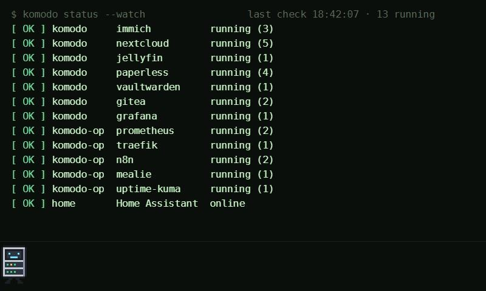
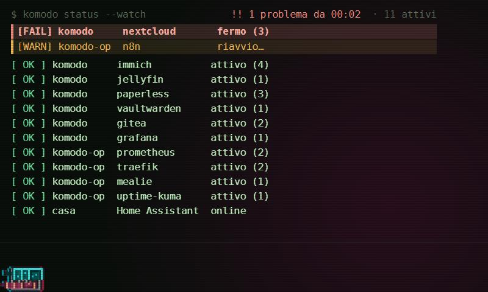

# Stack Status per DeskThing

🇬🇧 [Read in English](README.md)

Un'app [DeskThing](https://deskthing.app) per lo Spotify **Car Thing** che tiene d'occhio gli stack di
[Komodo](https://komo.do) (due installazioni di Komodo Core) e **Home Assistant**, con un layout in
stile terminale. I servizi fermi restano fissi in cima in rosso; quelli attivi scorrono lentamente sotto.

| Tutto ok | Uno stack è giù |
|---|---|
|  |  |

*Screenshot alla risoluzione del Car Thing (800×480), con dati di esempio, in inglese (lingua predefinita).*

Una mascotte in pixel art, **Rackbot**, cammina lungo il fondo dello schermo. Quando qualcosa si rompe
inciampa, cade… e lo schermo va in **glitch**.

- Righe `[ OK ]` / `[WARN]` / `[FAIL]` per ogni stack, con il numero di servizi.
- Un Komodo Core che non risponde è già di per sé un allarme (nessun punto cieco, a differenza di un
  servizio di monitoraggio che può spegnersi anche lui).
- Nuovi allarmi: lo schermo del Car Thing si riaccende, il display "trema" e — se è aperta
  [Pi Status](https://github.com/franzo-ux/deskthing-pi-status) — il Car Thing passa a questa app.
- Interruttore "Allarme di prova" nelle impostazioni per provare tutta la catena senza rischi.
- **Italiano o inglese**: la lingua si sceglie nelle impostazioni (predefinita: inglese).

## Requisiti

- Un Car Thing con il firmware per DeskThing, collegato a un PC con **DeskThing ≥ 0.11**.
- **Node.js ≥ 20** sul PC (serve solo per compilare l'app).
- Una o due installazioni di **Komodo Core** raggiungibili dal PC, e una **chiave API** per ognuna.

## 1. Chiavi API di Komodo (sola lettura)

Su **ciascun** Komodo Core:

1. **Settings → Users** → crea un **Service User** (es. `deskthing`).
2. Dagli il permesso **Read** su **Servers** e **Stacks** (direttamente o tramite un gruppo).
   Senza permessi Komodo risponde con elenchi vuoti e l'app mostra `stack nessuno visibile (permessi?)`.
3. Su quell'utente: **API Keys → New API Key** e copia **key** e **secret** (il secret si vede una volta sola).

Non mettere mai le chiavi nel codice o in questo repository: vanno nelle impostazioni di DeskThing.

## 2. Compilare e installare

```bash
npm install
npm run build          # → dist/homelab
# chiudi DeskThing (icona vicino all'orologio → Esci), poi:
npm run deploy         # copia l'app in DeskThing e la registra
```

Riapri DeskThing e compila le impostazioni dell'app. Per aggiornare in futuro: `npm run build`,
`npm run deploy -- --files`, riavvia DeskThing.

## 3. Impostazioni (DeskThing → App → Stack Status)

| Impostazione | Significato |
|---|---|
| Language / Lingua | **English** (predefinita) o **Italiano**: lo schermo cambia subito, le voci delle impostazioni dopo il riavvio di DeskThing |
| komodo · indirizzo / API key / API secret | primo Komodo Core, es. `http://komodo-1.local:9120` |
| komodo-op · indirizzo / API key / API secret | secondo Komodo Core |
| Home Assistant · indirizzo | es. `http://homeassistant.local:8123` (controlla solo che risponda) |
| Altri servizi web | altri servizi da controllare come Home Assistant: `nome=indirizzo`, separati da virgole, es. `Uptime Kuma=http://kuma.local:3001` |
| Allarme di prova | accendilo per generare un allarme di prova, poi spegnilo |

I due posti per Komodo si chiamano `komodo` e `komodo-op` (chiavi delle impostazioni); per usarne uno
solo lascia l'altro senza chiavi (compare come avviso, non come allarme), oppure cancellane l'indirizzo per
nasconderlo del tutto. Se Home Assistant non risponde al suo indirizzo, l'app prova anche
`http://homeassistant.local:8123` (utile quando cambia indirizzo IP).
L'id dell'app è `homelab` (il suo primo nome): tienilo se fai un fork, le altre app lo cercano.

## Come funziona

- La parte sul PC chiede a ogni Komodo Core `ListServers` e `ListStacks` ogni 15 s (API di lettura,
  `X-Api-Key` / `X-Api-Secret`) e controlla che Home Assistant risponda.
- Stati degli stack: `running` = OK; `deploying`, `restarting`, `created`, `paused`, `removing`,
  `unknown` = avviso; tutto il resto (`stopped`, `down`, `dead`, `unhealthy`, …) = errore.
- A ogni nuovo errore scrive `apps/homelab/alert.json`: Pi Status e World Clock controllano quel file
  per mostrare l'allarme e cambiare app (il `sendToApp` di DeskThing 0.11 non funziona, vedi le note di Pi Status).
- La riaccensione dello schermo usa lo script di spegnimento installato da Pi Status (senza, non ha effetto).

## Mascotte personalizzata

Il display usa `app/client/mascot/walk_r0..7.png`, `walk_l0..7.png` (camminata a destra/sinistra) e
`fall0..5.png` (caduta; il glitch parte sull'ultimo fotogramma). Rackbot è generato da
`tools/rackbot_frames.py` (Pillow). Per usare un tuo personaggio sostituisci quei PNG mantenendo le
dimensioni (camminata 42×76, caduta 67×77) e i punti di ancoraggio in `app/client/main.ts`
(`WALK_*`, `FALL_*`). Non mettere immagini personali o di terzi in un fork pubblico.

## Licenza

[MIT](LICENSE): puoi usarlo, modificarlo e condividerlo liberamente.
